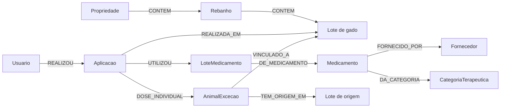

# Rastreabilidade do uso de um lote de medicamento

Esta proposta modela o alcance do uso de um lote de medicamento no Aplicativo. O grafo permite partir de um lote de fabricação recolhido e alcançar aplicações, lotes de gado, propriedades, aplicadores e animais de exceção com tratamento individual registrado.

## Pergunta de negócio

**Em quais propriedades e lotes de gado foi utilizado determinado lote de medicamento recolhido, quais animais de exceção possuem aplicação individual registrada e quem realizou as aplicações?**

## Diagrama do grafo

Lote de gado e Lote de origem representam o mesmo tipo de nó, **Lote**, com funções diferentes no desenho. LoteMedicamento representa o lote de fabricação e é uma entidade distinta.

## Nós e propriedades

Cada registro relacional origina um nó identificado pelo seu UUID `id`. Os nomes dos tipos são propostos; as propriedades listadas existem no esquema relacional consultado.

| Tipo de nó | Tabela de origem | Propriedades selecionadas |
|---|---|---|
| Propriedade | `property` | `id`, `name`, `city`, `state` |
| Rebanho | `herd` | `id`, `herd_name`, `breed`, `head_count` |
| Lote | `lot` | `id`, `lot_code`, `is_exception_lot`, `head_count`, `active` |
| Aplicacao | `application` | `id`, `application_date`, `application_time`, `dose`, `unit`, `route`, `head_count_applied`, `meat_withdrawal_end`, `active` |
| LoteMedicamento | `medicine_batch` | `id`, `batch_number`, `manufacture_date`, `expiry_date`, `status` |
| Medicamento | `medicine` | `id`, `brand_name`, `active_ingredient`, `meat_withdrawal_days` |
| Fornecedor | `supplier` | `id`, `company_name` |
| CategoriaTerapeutica | `therapeutic_category` | `id`, `name` |
| Usuario | `app_user` | `id`, `name` |
| AnimalExcecao | `animal_exception` | `id`, `ear_tag`, `status`, `exception_date`, `exception_end_date` |

## Relacionamentos e cardinalidades

As cardinalidades descrevem os vínculos do esquema: um nó de origem pode não ter filhos, aplicações ou animais associados. Cada aplicação, porém, possui exatamente um lote de gado, um lote de medicamento e um aplicador.

| Relacionamento | Cardinalidade | Origem relacional |
|---|---|---|
| Propriedade → CONTEM → Rebanho | 1:N | `herd.property_id` |
| Rebanho → CONTEM → Lote | 1:N | `lot.herd_id` |
| Aplicacao → REALIZADA_EM → Lote | N:1 | `application.lot_id` |
| Usuario → REALIZOU → Aplicacao | 1:N | `application.user_id` |
| Aplicacao → UTILIZOU → LoteMedicamento | N:1 | `application.medicine_batch_id` |
| LoteMedicamento → DE_MEDICAMENTO → Medicamento | N:1 | `medicine_batch.medicine_id` |
| Medicamento → FORNECIDO_POR → Fornecedor | N:1 | `medicine.supplier_id` |
| Medicamento → DA_CATEGORIA → CategoriaTerapeutica | N:1 | `medicine.therapeutic_category_id` |
| Aplicacao → DOSE_INDIVIDUAL → AnimalExcecao | N:N | `application_animal.application_id` e `animal_exception_id` |
| AnimalExcecao → VINCULADO_A → Lote | N:1 | `animal_exception.lot_id` |
| AnimalExcecao → TEM_ORIGEM_EM → Lote | N:1 | `animal_exception.origin_lot_id` |

**DOSE_INDIVIDUAL** representa uma linha de `application_animal` e guarda as propriedades `id`, `dose_given`, `weight_at_time`, `meat_withdrawal_end`, `released_for_slaughter` e `created_at`. Preserva-se a unicidade do par aplicação–animal existente no relacional.

O vínculo individual registra os dados específicos de cada animal. `VINCULADO_A` reflete o lote cadastrado, não necessariamente o lote na data da aplicação; a aplicação individual é comprovada por `DOSE_INDIVIDUAL`.

## Traversal que responde à pergunta

1. Localizar o nó LoteMedicamento pelo UUID. `RECOLHIDO` é um dos valores existentes de `medicine_batch.status`.
2. Percorrer UTILIZOU no sentido inverso para encontrar todas as aplicações registradas com esse lote de medicamento.
3. De cada aplicação, seguir REALIZADA_EM até o lote de gado.
4. Percorrer CONTEM no sentido inverso até o rebanho e a propriedade.
5. A partir da aplicação, percorrer REALIZOU no sentido inverso para identificar o aplicador.
6. Quando existir DOSE_INDIVIDUAL, percorrê-lo para identificar o animal de exceção com vínculo individual comprovado.

**Caminho principal:** LoteMedicamento ← Aplicacao → Lote ← Rebanho ← Propriedade.

**Ramificações:** Aplicacao → AnimalExcecao e Aplicacao ← Usuario.

## Resultado esperado

O resultado deve apresentar propriedade, rebanho, lote de gado, aplicação, data, quantidade de cabeças registrada na aplicação, aplicador e eventuais animais com dose individual. Cada linha deve preservar a identificação da aplicação para permitir verificar a origem da informação.

**Exemplo fictício:** o lote de medicamento M-27 aparece em duas aplicações, uma em ENG-01 e outra em ENG-04, ambas da Fazenda Horizonte. Uma delas possui vínculo individual com o animal B-018. O percurso também identifica Ana como aplicadora.
