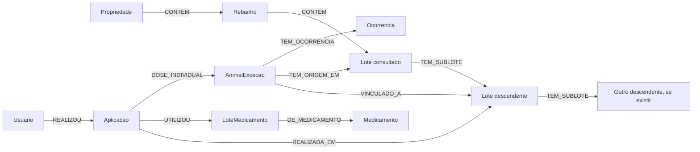

# Hierarquia de lotes e explicação de pendências

Esta proposta modela a hierarquia dos lotes do Argos e os registros operacionais ligados a cada ramo. O objetivo é identificar pendências nos sublotes descendentes de um lote e mostrar o caminho até as aplicações e ocorrências que precisam ser examinadas.

## Pergunta de negócio

**A partir de um lote de origem, quais sublotes descendentes possuem carências em aberto ou animais de exceção com ocorrências não resolvidas, e quais registros explicam essas pendências?**

## Diagrama do grafo

Lote consultado, Lote descendente e Outro descendente são representações do mesmo tipo **Lote**. O desenho ilustra a possibilidade estrutural de vários níveis, sem afirmar que existam registros com essa profundidade na base. As ramificações operacionais podem existir em qualquer lote da hierarquia.

## Nós e propriedades

| Tipo de nó | Tabela de origem | Propriedades selecionadas |
|---|---|---|
| Propriedade | `property` | `id`, `name` |
| Rebanho | `herd` | `id`, `herd_name` |
| Lote | `lot` | `id`, `lot_code`, `category`, `is_exception_lot`, `exception_reason`, `head_count`, `open_date`, `close_date`, `active`, `fit_for_slaughter`, `slaughter_release_date` |
| AnimalExcecao | `animal_exception` | `id`, `ear_tag`, `status`, `exception_date`, `exception_end_date`, `fit_for_slaughter`, `slaughter_release_date` |
| Aplicacao | `application` | `id`, `application_date`, `application_time`, `meat_withdrawal_end`, `dose`, `unit`, `head_count_applied`, `active` |
| LoteMedicamento | `medicine_batch` | `id`, `batch_number` |
| Medicamento | `medicine` | `id`, `brand_name`, `meat_withdrawal_days` |
| Ocorrencia | `occurrence` | `id`, `type`, `occurrence_date`, `description`, `diagnosis`, `resolved`, `resolved_at` |
| Usuario | `app_user` | `id`, `name` |

Cada nó utiliza o UUID relacional como identidade. Categoria e condição de exceção permanecem propriedades do lote: no SQL atual, `category` admite `ENGORDA`, `CRIA` e `RECRIA`; a exceção é indicada por `is_exception_lot`.

## Relacionamentos e cardinalidades

| Relacionamento | Cardinalidade | Origem relacional |
|---|---|---|
| Propriedade → CONTEM → Rebanho | 1:N | `herd.property_id` |
| Rebanho → CONTEM → Lote | 1:N | `lot.herd_id` |
| Lote pai → TEM_SUBLOTE → Lote filho | 1:N | `lot.parent_lot_id` no filho |
| Aplicacao → REALIZADA_EM → Lote | N:1 | `application.lot_id` |
| Aplicacao → UTILIZOU → LoteMedicamento | N:1 | `application.medicine_batch_id` |
| LoteMedicamento → DE_MEDICAMENTO → Medicamento | N:1 | `medicine_batch.medicine_id` |
| Usuario → REALIZOU → Aplicacao | 1:N | `application.user_id` |
| Aplicacao → DOSE_INDIVIDUAL → AnimalExcecao | N:N | `application_animal` |
| AnimalExcecao → VINCULADO_A → Lote | N:1 | `animal_exception.lot_id` |
| AnimalExcecao → TEM_ORIGEM_EM → Lote | N:1 | `animal_exception.origin_lot_id` |
| AnimalExcecao → TEM_OCORRENCIA → Ocorrencia | 1:N | `occurrence.animal_exception_id` |

Cada lote possui zero ou um pai e pode possuir vários filhos. O banco possui uma trigger que verifica ciclos na hierarquia; a carga para o grafo também deve validar os dados e evitar repetição de lotes no percurso. Cada ocorrência pertence exatamente a um animal de exceção.

DOSE_INDIVIDUAL guarda os campos de `application_animal`: `id`, `dose_given`, `weight_at_time`, `meat_withdrawal_end`, `released_for_slaughter` e `created_at`.

Para distinguir vínculo cadastral de permanência física, pode-se incluir também **AnimalExcecao → TEVE_PERMANENCIA_EM → Lote**, com `id`, `entry_date`, `exit_date` e `reason` de `animal_lot_history`. Esse relacionamento temporal é complementar e não substitui VINCULADO_A.

## Traversal que responde à pergunta

1. Localizar o lote de origem pelo UUID.
2. Percorrer TEM_SUBLOTE repetidamente, visitando todos os descendentes existentes. A quantidade de passos depende da hierarquia encontrada.
3. Para cada descendente, identificar aplicações pelo relacionamento REALIZADA_EM, percorrido no sentido inverso.
4. Para uma data de referência informada, identificar carências com `meat_withdrawal_end` posterior a essa data, tanto na aplicação quanto em DOSE_INDIVIDUAL. Essa comparação segue o SQL, que considera a carência encerrada no próprio dia final. Sinalizar data nula para revisão: as views existentes a tratam como liberada, mas ela não informa o fim da carência.
5. Identificar animais vinculados ao descendente e percorrer TEM_OCORRENCIA para encontrar ocorrências com `resolved = false`.
6. Seguir de cada aplicação ao lote de medicamento e ao medicamento para contextualizar a pendência.
7. Retornar o caminho completo entre o lote inicial, o descendente e os registros encontrados.

**Caminho da carência coletiva:** Lote de origem → um ou mais descendentes ← Aplicacao → LoteMedicamento → Medicamento.

**Caminho da ocorrência:** Lote de origem → um ou mais descendentes ← AnimalExcecao → Ocorrencia.

**Caminho da carência individual:** Aplicacao → DOSE_INDIVIDUAL → AnimalExcecao, mantendo o vínculo da aplicação com o lote em que foi registrada.

O vínculo cadastral do animal com o lote pode mudar; use o histórico de permanência para investigar sua localização em uma data passada. A view relacional `vw_linhagem_lote` percorre ancestrais; esta proposta também percorre descendentes.

## Resultado esperado

Cada resultado apresenta o lote inicial, a sequência de descendentes, o tipo de pendência e o registro que a explica. Para carência, inclui a aplicação, o medicamento e o fim de carência registrado; para ocorrência, inclui animal, tipo, data e situação de resolução.

**Exemplo fictício:** ENG-01 possui o descendente EXC-01. Nesse sublote há uma aplicação com carência posterior à data de referência e o animal B-018 possui uma ocorrência não resolvida. A resposta mostra os caminhos ENG-01 → EXC-01 → aplicação e ENG-01 → EXC-01 → B-018 → ocorrência.
