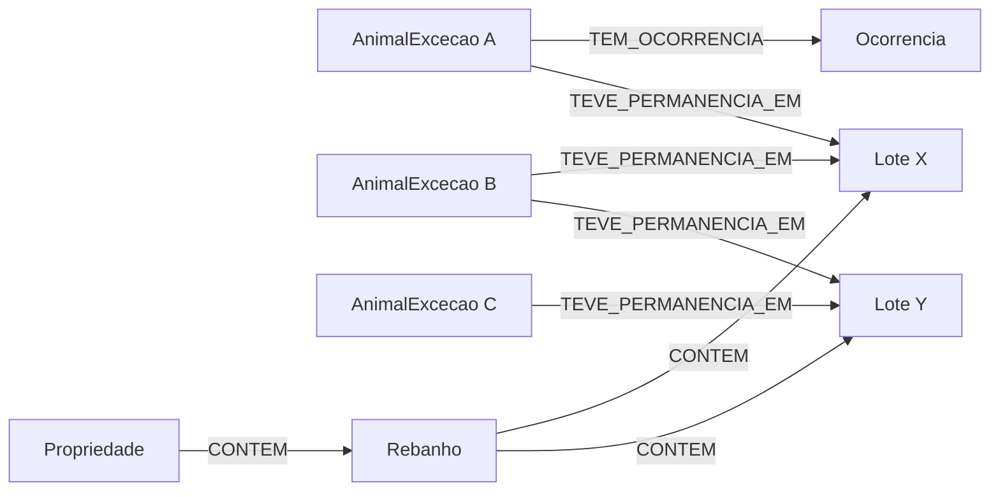

# Rede temporal de compartilhamento de lotes

Esta proposta modela os lotes em que os animais de exceção permaneceram e os intervalos de cada permanência. O grafo permite identificar animais registrados que compartilharam lotes durante períodos sobrepostos e investigar conexões por intermediários.

## Pergunta de negócio

**Quais animais de exceção compartilharam lotes, em períodos sobrepostos, com um animal que possui uma ocorrência de doença? Quais outros animais são alcançados por uma segunda etapa dessa rede, respeitando a sequência temporal?**

## Diagrama do grafo

AnimalExcecao A, B e C são instâncias do mesmo tipo de nó. Lote X e Y também são instâncias do mesmo tipo **Lote**. As letras apenas distinguem os participantes do percurso ilustrativo.

Cada seta TEVE_PERMANENCIA_EM possui suas próprias datas. O compartilhamento é determinado pela comparação dos intervalos de duas setas que chegam ao mesmo lote.

## Nós e propriedades

| Tipo de nó | Tabela de origem | Propriedades selecionadas |
|---|---|---|
| AnimalExcecao | `animal_exception` | `id`, `ear_tag`, `status`, `exception_date`, `exception_end_date` |
| Lote | `lot` | `id`, `lot_code`, `is_exception_lot`, `open_date`, `close_date`, `active` |
| Ocorrencia | `occurrence` | `id`, `type`, `occurrence_date`, `description`, `diagnosis`, `resolved`, `resolved_at` |
| Rebanho | `herd` | `id`, `herd_name` |
| Propriedade | `property` | `id`, `name` |

Os nós preservam os UUIDs relacionais. Não se criam animais individuais a partir de `lot.head_count`.

## Relacionamentos e cardinalidades

| Relacionamento | Cardinalidade | Origem relacional |
|---|---|---|
| AnimalExcecao → TEVE_PERMANENCIA_EM → Lote | N:N, com várias permanências possíveis por par | `animal_lot_history` |
| AnimalExcecao → TEM_OCORRENCIA → Ocorrencia | 1:N | `occurrence.animal_exception_id` |
| Rebanho → CONTEM → Lote | 1:N | `lot.herd_id` |
| Propriedade → CONTEM → Rebanho | 1:N | `herd.property_id` |

**Propriedades de TEVE_PERMANENCIA_EM:**

| Propriedade | Origem e significado |
|---|---|
| `id` | UUID da linha de `animal_lot_history`; identifica aquela permanência |
| `entry_date` | Data de entrada no lote |
| `exit_date` | Data de saída; pode ser nula |
| `reason` | Motivo registrado para a permanência ou movimentação |
| `created_at` | Data de criação do registro |

O relacionamento é criado uma vez para cada linha do histórico. Se um animal sai e retorna ao mesmo lote, existem duas relações distintas, preservadas pelos IDs do histórico. Não consolidar ambas em um único intervalo.

## Traversal que responde à pergunta

1. Localizar a ocorrência de interesse com `type = DOENCA` e percorrer TEM_OCORRENCIA no sentido inverso até o animal A.
2. Percorrer as permanências de A que cruzam a janela analisada e alcançar seus lotes.
3. De cada lote, percorrer TEVE_PERMANENCIA_EM no sentido inverso até outros animais registrados.
4. Comparar as datas das permanências. Manter como primeira etapa somente animais com sobreposição válida com A.
5. Para cada animal B encontrado, explorar suas outras permanências e localizar animais C que compartilharam esses outros lotes.
6. Na segunda etapa, exigir a existência de uma sequência temporal em que o compartilhamento B–C ocorra no mesmo momento ou após algum momento do compartilhamento A–B. Um compartilhamento exclusivamente anterior não representa continuidade temporal desse percurso.
7. Retornar os caminhos e os intervalos que os sustentam. Impedir a repetição de um animal no mesmo caminho para evitar ciclos na explicação.

**Primeira etapa:** Animal A → Lote X ← Animal B.

**Segunda etapa:** Animal A → Lote X ← Animal B → Lote Y ← Animal C.

Os passos de traversal são as relações animal–lote. Uma etapa de compartilhamento entre dois animais corresponde a dois passos. Uma conexão indireta por B corresponde a quatro passos a partir de A.

## Resultado esperado

| Informação no resultado | Finalidade |
|---|---|
| Animal inicial e ocorrência | Identificar a origem da investigação |
| Animal alcançado | Identificar o registro a examinar |
| Etapa de compartilhamento | Distinguir relação direta de relação por intermediário |
| Sequência de animais e lotes | Explicar como o animal foi alcançado |
| IDs das permanências e datas sobrepostas | Permitir verificar a evidência do caminho |
| Ambiguidade de fronteira de datas | Explicitar quando não há precisão para afirmar simultaneidade |

**Exemplo fictício:** A possui permanência no lote X de 01/10 a 05/10, e B permanece no mesmo lote de 03/10 a 06/10. Há sobreposição de 03/10 a 05/10. Depois, B permanece no lote Y de 07/10 a 10/10, e C permanece em Y de 08/10 a 12/10. C é alcançado na segunda etapa pelo caminho A → X → B → Y → C, com a segunda sobreposição de 08/10 a 10/10. As datas e animais são apenas ilustrativos, sem consulta à base.

**ATENÇÃO** Isso responde quem compartilhou lotes e por quais caminhos. Não permite concluir que B ou C estejam doentes ou que A tenha transmitido uma doença.
